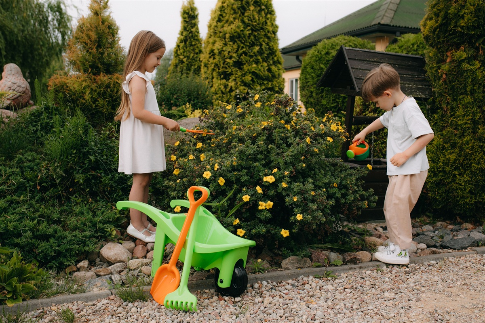
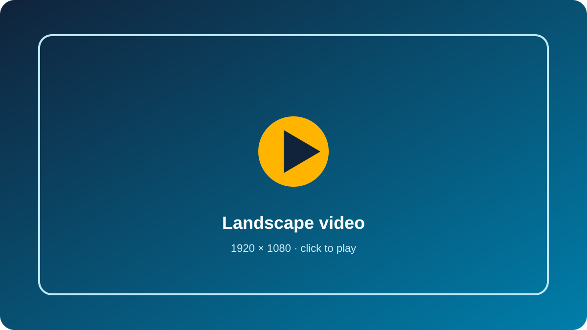
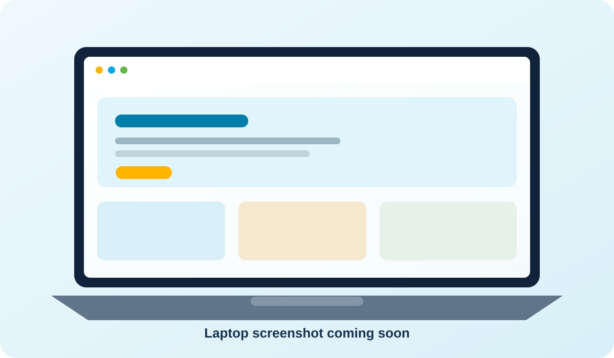

# Helping Hand Haven

### A place to belong. A future to build.

A responsive, six-page website for a South African children's home, created for the WEDE5020 Portfolio of Evidence.

[Explore the website](index.html) · [Watch the videos](#video-showcase) · [See the project features](#what-the-website-includes)

> **About the cover image:** this is an illustrative stock photo, not a photograph of Helping Hand Haven residents.

---

## Welcome

Helping Hand Haven is a non-profit organisation founded in 2000 by Luyanda Prince Shandu. Its mission is to provide children who have not been adopted, and young people who need a safe home, with care, education and a stable family environment.

This project presents that mission through a warm, welcoming website. Clear navigation, accessible forms, responsive layouts and a photo gallery help visitors learn about the home and get in touch.

## Video showcase

The two supplied video files are included in this repository. Select a preview card to open its video.

<table>
  <tr>
    <td align="center">
      
       <strong>Landscape video</strong> 1920 × 1080
    </td>
    <td align="center">
      
       <strong>Vertical video</strong> 2160 × 3840
    </td>
  </tr>
</table>

## Website previews

Replace these illustrated placeholders with the laptop and phone screenshots when they are ready.

<table>
  <tr>
    <th align="center">Laptop view</th>
    <th align="center">Phone view</th>
  </tr>
  <tr>
    <td></td>
    <td></td>
  </tr>
</table>

### YouTube walkthrough

Your YouTube video placeholder is ready. Add the video link and thumbnail here when you have them.

## What the website includes

| Page | What visitors can do |
|---|---|
| **Home** | Learn about Helping Hand Haven, its mission and ways to support the children. |
| **About Us** | Read about the organisation's history, values and caregiving team. |
| **What We Do** | Explore the home's three pillars: a stable home, education and daily care. |
| **Gallery** | Browse activity photos and open them in a keyboard-accessible lightbox. |
| **Enquiry** | Send a volunteer or sponsorship enquiry through a validated form. |
| **Contact** | Find contact details, view the map and send a message. |

### Designed around the people using it

- Responsive navigation and layouts for laptop, tablet and phone screens.
- Forms check names, email addresses, phone numbers and required messages before sending.
- Form submissions provide clear success or retry feedback.
- Gallery photos open larger with previous/next controls and keyboard support.
- Motion effects respect the visitor's reduced-motion setting.
- Each page has its own title, description and keywords; image alt text, robots.txt and sitemap.xml support search discovery.

## Run the website locally

1. Download or clone this repository and open its folder in Visual Studio Code.
2. Start the site with the Live Server extension, or another local web server.
3. Open index.html through the local server and use the navigation to explore each page.

FormSubmit handles contact and enquiry messages. Its inbox owner must confirm the first activation email before messages can be delivered. The forms need a local web server and do not submit from a file:// address.

## Project details

- **Student:** Luyanda Shandu
- **Student number:** ST10514191
- **Module:** WEDE5020 — Web Development (Introduction)
- **Programme:** Higher Certificate in Mobile Application and Web Development
- **Built with:** HTML5, CSS3 and JavaScript
- **Hosting target:** GitHub Pages
- **Planned domain:** helpinghandhaven.org.za

### Project structure

~~~
/
├── .github/workflows/autograde.yaml
├── index.html, about.html, what-we-do.html
├── gallery.html, enquiry.html, contact.html
├── css/styles.css
├── js/script.js
├── images/
├── docs/readme/
└── videos/
~~~

The detailed development record is in [CHANGELOG.md](CHANGELOG.md). The sitemap is available in [images/sitemap.png](images/sitemap.png).

<strong>Coursework notes, planning and references</strong>

### Goals and measures

- Increase donations from individuals and corporate donors.
- Raise awareness of the cause and the spirit of *umuntu ngumuntu ngabantu*.
- Recruit volunteers and support placement enquiries from social workers.

**Measures:** donation form submissions, volunteer sign-ups and enquiries from social workers and sponsors.

### Milestones

| Milestone | Target date |
|---|---|
| Project planning and proposal approval | 1 September 2026 |
| HTML structure for all six pages (Part 1) | 1 September 2026 |
| CSS design and responsive layouts (Part 2) | September 2026 |
| Part 2 submission | 5 October 2026 |
| JavaScript functionality and SEO (Part 3) | 9 November 2026 |

### Development summary

**Part 1 — Planning and structure**
- Selected Helping Hand Haven as the target organisation and prepared the proposal, goals, measures and wireframes.
- Built semantic HTML structure for the six pages and set up the project folders.

**Part 2 — Visual design**
- Created a shared stylesheet, responsive layouts, Poppins and Open Sans typography, colour palette, page cards and navigation.
- Added responsive image sizes, visible keyboard focus, labelled navigation and reduced-motion support.

**Part 3 — Functionality and SEO**
- Added client-side validation and asynchronous form handling for enquiry and contact forms.
- Added an accessible gallery lightbox, responsive maps and subtle scroll reveals.
- Added unique page titles, descriptions and keywords, plus robots.txt and sitemap.xml.
- The GitHub Actions workflow is manual-only because this assignment has no built-in autograder.

### Budget estimate

| Item | Estimate |
|---|---:|
| .org.za domain | R99–R150 per year |
| GitHub Pages hosting | R0 |
| Development | R0 |
| Images | R0 |
| Maintenance allowance | R0–R500 per year |
| **Estimated total** | **about R99–R650 per year** |

### References

- Coddy.tech (n.d.), *Learn HTML*: https://coddy.tech/landing/html
- freeCodeCamp.org (2022), *Learn HTML — Full Tutorial for Beginners*: https://www.youtube.com/watch?v=kUMe1FH4CHE
- GitHub Docs (n.d.), *What is GitHub Pages?*: https://docs.github.com/en/pages/getting-started-with-github-pages
- Google Fonts (2026), [Poppins](https://fonts.google.com/specimen/Poppins) and [Open Sans](https://fonts.google.com/specimen/Open+Sans)
- HirenEmeris (n.d.), [student_site repository](https://github.com/HirenEmeris/student_site)
- MDN Web Docs (n.d.), [CSS layout](https://developer.mozilla.org/en-US/docs/Learn_web_development/Core/CSS_layout), [media queries](https://developer.mozilla.org/en-US/docs/Web/CSS/CSS_media_queries/Using_media_queries), [responsive images](https://developer.mozilla.org/en-US/docs/Learn_web_development/Core/Structuring_content/HTML_images#responsive_images), [CSS units](https://developer.mozilla.org/en-US/docs/Learn_web_development/Core/Styling_basics/Values_and_units) and [reduced motion](https://developer.mozilla.org/en-US/docs/Web/CSS/@media/prefers-reduced-motion)
- Open Arms Home for Children (2026): https://www.openarmshome.com/
- Pexels (n.d.), illustrative image assets: [garden](https://images.pexels.com/photos/19255400/pexels-photo-19255400.jpeg), [home](https://images.pexels.com/photos/4221413/pexels-photo-4221413.jpeg), [education](https://images.pexels.com/photos/8617993/pexels-photo-8617993.jpeg) and [care](https://images.pexels.com/photos/7879719/pexels-photo-7879719.jpeg)
- Register Domain SA (n.d.), *Domain Registration in South Africa*: https://www.registerdomain.co.za/blog/?p=811
- SuperSimpleDev (n.d.), *HTML and CSS Full Course*: https://youtu.be/G3e-cpL7ofc
- W3Schools (n.d.), [HTML id attribute](https://www.w3schools.com/html/html_id.asp)
- WHTop (2026), [domains.co.za pricing](https://www.whtop.com/plans/domains.co.za/141708)
- ZADNA (n.d.), [.za Domain Name Authority](https://www.zadna.org.za)
- Wireframes 1–5: https://ivory-memo-95080924.figma.site/
- Sitemap wireframe: https://load-nova-68778060.figma.site/
- FormSubmit (n.d.), [AJAX documentation](https://formsubmit.co/ajax-documentation) and [form documentation](https://formsubmit.co/documentation)

### Design and implementation notes

- One shared external stylesheet keeps the visual system consistent across all six pages.
- Poppins is used for headings and Open Sans for body copy; relative units and a type scale support browser zoom and readability.
- Flexbox and CSS Grid organize the header, cards, gallery, team, page sections and responsive footer.
- The blue, gold and green palette, rounded cards, gentle shadows and clear focus states carry the same visual language throughout the site.
- Responsive layouts use 1024px, 768px and 480px breakpoints. The compact navigation remains available at tablet and phone widths.
- Local images include 480px, 800px, 1200px and 1600px variants. Descriptive alt text, active-page navigation labels and reduced-motion support improve accessibility.
- HTML5 provides the page structure, CSS3 handles layout and presentation, and plain JavaScript powers form validation, navigation, the gallery lightbox and scroll reveals.

### Before publishing

- The first FormSubmit activation email must be confirmed by the inbox owner before form delivery is enabled.
- If the site is published at a different address, update the URLs in robots.txt, sitemap.xml and the forms.
- Form details pass through FormSubmit, an external email service, before reaching the inbox.
- Add the organisation's official social profiles and any confirmed backlinks when those details are available.

### Additional references

- 118Group (n.d.), *Color theory 101: the ultimate nonprofit guide*: https://118group.com/research/color-theory-101-nonprofit-guide/
- Door of Hope (2026), *Giving Hope, Changing Futures*: https://doorofhope.co.za/
- MDN Web Docs (n.d.), [CSS pseudo-classes](https://developer.mozilla.org/en-US/docs/Web/CSS/Pseudo-classes)
- Pexels (n.d.), homepage hero image, photo 33168484: https://images.pexels.com/photos/33168484/pexels-photo-33168484.jpeg
- Pexels (n.d.), homepage learning image, photo 5088174: https://images.pexels.com/photos/5088174/pexels-photo-5088174.jpeg
- Pexels (n.d.), homepage playtime image, photo 19255400: https://images.pexels.com/photos/19255400/pexels-photo-19255400.jpeg
- Pexels (n.d.), homepage bedtime image, photo 5951837: https://images.pexels.com/photos/5951837/pexels-photo-5951837.jpeg
- Pexels (n.d.), caregiving team photos: https://images.pexels.com/photos/20209020/pexels-photo-20209020.jpeg, https://images.pexels.com/photos/12437056/pexels-photo-12437056.jpeg and https://images.pexels.com/photos/2362887/pexels-photo-2362887.jpeg
- Pexels (n.d.), home service image, photo 4221413: https://images.pexels.com/photos/4221413/pexels-photo-4221413.jpeg
- Pexels (n.d.), education service image, photo 8617993: https://images.pexels.com/photos/8617993/pexels-photo-8617993.jpeg
- Pexels (n.d.), care service image, photo 7879719: https://images.pexels.com/photos/7879719/pexels-photo-7879719.jpeg
- Register Domain SA (n.d.), domain cost guide: https://www.registerdomain.co.za/blog/?p=811
- WHTop (2026), domains.co.za pricing: https://www.whtop.com/plans/domains.co.za/141708

